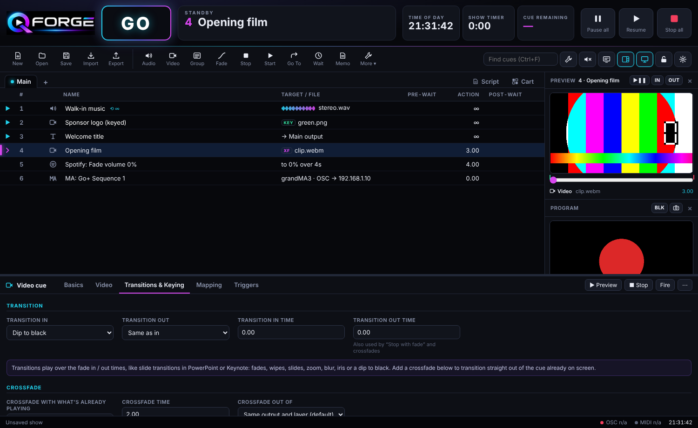

<p align="center"></p>

# QForge — show playback for Windows & macOS (v1.5)

QForge is a cue-based playback app by Booth Productions, in the style of QLab. It runs audio, video, image, text, camera, fade, group, MIDI, OSC, MA Lighting and app-control cues from one GO button. It also offers projection mapping, a web remote and live collaboration.



## Download

Get the latest build from the [**Releases**](../../releases) page:

| Platform | File | Install |
|---|---|---|
| Windows 10/11 (64-bit) | `QForge-Windows-x64.zip` | Extract the zip, then run **Install QForge.bat**. You can also run `QForge.exe` directly. If SmartScreen warns, choose *More info → Run anyway*. |
| Mac with Apple Silicon (M1–M4) | `QForge-mac-AppleSilicon.zip` | Unzip, right-click **Install QForge.command**, then choose **Open**. |
| Mac with Intel | `QForge-mac-Intel.zip` | Same as Apple Silicon. |

The apps aren't code-signed with paid certificates, so Windows and macOS warn the first time you open them.

## Run or build from source

You need [Node.js](https://nodejs.org) 20 or newer.

```bash
npm install
npm start            # run QForge
npm run dist:win     # Windows installer + portable exe  -> dist/
npm run dist:mac     # Mac dmg + zip (Intel and Apple Silicon) -> dist/
```

On Windows you can also double-click `START-Windows.bat`; on a Mac, `start-mac.command`.

**Automatic builds:** the *Build QForge* workflow (`.github/workflows/build.yml`) builds Windows and Mac versions on GitHub's machines.
- Run it from the **Actions** tab to get the builds as downloadable artifacts.
- Publish a release and the installers are attached to it automatically.

## Project layout

```
main.js, preload.js   Electron main process + secure bridge
lib/                  OSC, Art-Net/sACN, web remote & collaboration server, Telnet, app control
src/                  The app UI and playback engine (HTML/CSS/JS, no build step)
src/remote/           Web remote / stage-manager view served to phones and tablets
build/icon.png        App icon
```

---

## New in 1.5

- **Preview and Program monitors (right-hand panel)**
  - *Preview* shows the cue in standby: video with a scrub bar and IN/OUT buttons, images, text, a live camera picture, a waveform for audio, or a group's contents.
  - *Program* is a live mirror of what's on the outputs, with Blackout and Screenshot buttons.
  - *Now Playing* lists running cues, with waveforms.
  - Close any panel with ×. Reopen it from the **Panels** button or the View menu (Ctrl/⌘+Alt+1/2/3).
- **Minimal show view**: locking the show (Ctrl/⌘+L) switches to a stripped-back layout with a big GO, standby, a large cue list, the monitors and Now Playing. You can turn this off in Settings → General.
- **App control cue**
  - Controls Spotify, Apple Music or any media player on the same computer: play/pause, next/previous, set or fade the volume, and play a Spotify link or a Music playlist.
  - On Mac it controls the apps directly. On Windows it uses media keys and the system volume.
- **MA Lighting cue**
  - grandMA3 over OSC (command line).
  - grandMA2 over Telnet on port 30000, with automatic login and a kept-open connection.
  - Either console over MIDI Show Control (GO / STOP / RESUME with cue and list).
  - Includes command templates.
- **Transitions**: 14 PowerPoint-style transitions for video, image, text and camera cues: fade, cut, dip to black, wipes, push slides, zoom, blur and iris. You can set a separate transition for in and for out.
- **Per-cue crossfade**
  - *Auto*: what's already playing fades out as the new cue comes in (equal-power for audio). For visuals, this works on the same layer, the same output, or everything.
  - *Manual*: the cue waits until you move the T-bar under the Program monitor, press Take (Ctrl/⌘+Shift+X), or move a MIDI fader or an OSC `/xfade` control.
- **Keying and background removal**: green/blue-screen chroma key (with auto colour pick), luma key, and one-click background removal for images on plain backgrounds. Keying runs live on the GPU and works on video, images and cameras.
- **Vocal tools**: remove vocals (karaoke / backing track) or isolate vocals on stereo files. This is a centre-channel technique, so results depend on the mix.
- **Surround**: 5.1, 7.1 and quad files show their channels. Turn on surround to map each channel to an interface output (with presets), or leave it off to fold down to stereo.
- **Waveforms on/off** in the cue list, in Now Playing / Preview, and on the web remote and stage manager view (press W on the SM screen).
- **Output screenshots**: Ctrl/⌘+Alt+S, the camera button or OSC `/screenshot` saves a PNG of every open output to a folder you choose (default: Pictures/QForge Screenshots).
- **Bluetooth and wireless**
  - Bluetooth and AirPlay speakers are tagged in the device lists, and you're warned if one disconnects.
  - Presentation clickers work out of the box: Page Down = GO, Page Up = back, B or . = black out.
  - Bluetooth MIDI works on Mac, and on Windows through the WinRT MIDI backend.
- **Better drag and drop**
  - Text and lyric files (.txt, .srt, .lrc) become title cues; lyric files become a Step group, one cue per verse.
  - .m3u playlists become playlist groups.
  - Hold Alt/Option while dropping to make one playlist or slideshow group.
  - Drop a file on the inspector to replace a cue's media.
- **In/Out points**: press I or O while a cue plays, or use the IN/OUT buttons in Preview, to set its In and Out points.
- **Cameras**: choose capture resolution and frame rate, refresh the camera list, see a live camera preview, and use chroma key on live cameras.

## New in 1.4

- **Built-in templates** — File → New offers Blank, Theatre, Corporate, Wedding, Band/Gig, Sports, Installation/Loop, Church/Service and Broadcast. Each sets up cue lists, cart buttons and settings with "(add file)" placeholders ready to relink.
- **Audio device patches** — any cue can play to a specific system output (e.g. a USB interface, HDMI or a Bluetooth speaker) as listed in your OS sound settings. Name patches like *Mains*, *Monitors* or *Effects* in Settings → Audio, then point cues at the patch. If you move to another machine you only re-patch once. Click "Show device names" if the list only shows generic names.
- **Collaboration over IP** — Settings → Remote → Collaboration. One machine *hosts* the session. Others *join* with the host's IP address (e.g. `192.168.1.20:8080`) and PIN. Edits sync live in both directions, and coloured badges show who is selecting which cue. The last edit wins. Edits made while someone is typing are held until they finish.
- **Video mapping**
  - *Per cue (Mapping tab)*: position, size, rotation, crop and mirror, plus quick layouts (full, halves, quadrants, PiP). Corner-pin dragging works live on the output.
  - *Per surface*: corner-pin keystone or a full **mesh warp** grid (up to 9×9) for curved or odd surfaces. **Masks** are drawn polygons with feather and invert, for blacking out areas or shaping to a set piece.
- **NDI** — native NDI needs the proprietary NDI SDK, so QForge works alongside the free **NDI Tools**:
  - *Out*: set a surface to "NDI capture window". It opens at an exact size with the title `QForge NDI - <name>`. Capture it with NDI Screen Capture (Windows) or NDI Scan Converter / Capture (Mac).
  - *In*: NDI Virtual Input / NDI Webcam appears as a camera source, labelled NDI ▸ in camera cues.
- **New group modes**
  - **Random one**: fires a single random child each GO and avoids repeats.
  - **Slideshow**: steps through children with a set slide time and optional crossfade.
  - **Step through**: each GO plays the next child, with optional wrap.
- **Group end actions** (what happens after the last child): **Stop**, **Repeat group only**, **Continue to next cue**, **Go to cue** (moves the playhead) or **Fire cue**.
- **Windows and Mac Intel builds**: there are now builds for Windows x64, Mac Apple Silicon and Mac Intel.

## New in 1.3.1 — Time & Loops waveform editor
Audio cues now have a QLab-style **Time & Loops** tab:
- **The waveform**: a separate lane for each channel (L/R, or up to 4), a time ruler, −6/−12 dB guide lines, and colour that fades out beyond the trim points.
- **Zoom and scroll**:
  - Mouse wheel zooms around the cursor; Shift-wheel or dragging scrolls.
  - The **−/+**, **Fit** and **Trim** buttons zoom out, zoom in, show the whole file, or show the IN–OUT region.
  - Double-click to fit the whole file.
  - The overview strip underneath shows the whole file; click or drag it to move the view.
- **Handles you can drag**: the **IN/OUT** trim flags, the yellow **fade-in/fade-out** handles (the fade curve is drawn on the wave), and **markers**.
  - Alt-click adds or removes a marker. Drag a marker to move it, or right-click it to delete.
  - Split the cue into separate cues at its markers.
- **Playback**:
  - Live playheads, and **Follow** keeps the playhead in view while zoomed in.
  - Shift-click sets the load-to-time point, or jumps playback if the cue is running.
  - **▶ From start** and **▶ From load point** preview the cue through the headphone or preview output.
- **Loops**: the play count is shown on the wave. The start, end, fade, loop, rate and preserve-pitch fields sit underneath and stay in step with the wave as you drag.

## New in 1.3

- **Version history** (Tools → Version history): every save keeps the previous version, up to the last 20 for each show. Opening an old version loads it as unsaved changes, so nothing is overwritten until you save.
- **House music playlists**: playlist and shuffle groups can **crossfade** between items, and can **resume** from the next track the next time they're started.
- **Fade out on GO**: any cue can be set to fade out when the next GO is pressed. Typical use is walk-in music that fades as the show starts.
- **Show-start countdown** (Settings → General): a "Show starts in" box appears in the header, the SM view and the web remote. It turns orange in the last 5 minutes. Text cues can show it with `{showstart}`.
- **Department notes**: sound, lighting and video notes on each cue. They show under standby, in the SM view and on the remote.
- **Record input** (Tools → Record input): record from any input with a level meter. The recording becomes an audio cue straight away, saved in a `Recordings` folder next to the show.
- **Admin PIN** (Settings → General): when set, unlocking show mode and the other admin actions need the PIN. Lock the show before you hand it over to an operator.
- **Show statistics** (Tools → Show statistics): records actual running times across rehearsals and shows, and compares them with the planned times (including cues stopped early). Export them to CSV. The statistics are saved with the show.
- **Audio markers and split**: Alt-click the waveform to add or remove markers, then **Split into cues** to turn one long soundtrack into separate cues.
- **Waveform thumbnails** next to audio cues in the cue list.
- **Speaker alignment** (Settings → Audio): delay, trim, polarity and mute for each output channel of each device. Use it to time-align fills and delay speakers (about 2.9 ms per metre).
- **Script / hit-list mode** (the Script tab, or Ctrl/⌘+J):
  - Paste or load your script, then link cues to lines.
  - The standby line is highlighted and scrolls to follow the show, and running cues are tinted.
  - Click a linked line to put its cue in standby.
- **Headphone preview** (Settings → Audio): the inspector's ▶ Preview button plays through a separate output, so you can audition cues during the show.

## New in 1.2

- **Level meters** in the Active Cues panel:
  - Every output channel of each device in use shows a meter with peak hold and a clip light (click the light to reset it).
  - Each running audio or mic cue gets its own small meter.
- **Master limiter** (Settings → Audio, on by default, ceiling −1 dBFS) protects the PA. The **LIM** light comes on when it's reducing gain. It only runs on stereo outputs, so multichannel routing is never downmixed.
- **Auto-ducking**: tick "Duck other audio while this plays" on an announcement or VO cue. Everything else dips by the amount you set and comes back up after the recovery time when the cue ends. Any cue can be set to **never duck**.
- **Mic / line input cue**: a live input with level, pan, EQ, routing, fades and auto-ducking (on by default, so music dips under announcements). Expect a little latency; for a lectern mic in the PA, use the desk.
- **Time-of-day triggers** (Inspector → Triggers): a cue fires every day at a set clock time, such as `19:30` for house music or `19:55:00` for a doors announcement.
- **Rehearsal mode** (toolbar button, or Ctrl/⌘+⇧H): mutes all audio and holds back MIDI, OSC, DMX, timecode and script cues, so you can run the show silently. Video and text still play.
  - An orange banner shows on the app and on every web remote.
  - Everything held back is written to the log.
- **Right-click a cue** to fire it, stop it, put it in standby, add a fade-out-and-stop, Stop, Start or Devamp cue for it, arm or disarm it, recolour it, duplicate, group or delete.
- **Edit several cues at once**: select multiple cues and the inspector edits them together. You can change colour, continue mode, pre/post-wait, armed, fades, level, output device, surface and layer. Fields that differ between cues show as "mixed" and stay unchanged unless you set them.
- **OSC device templates** in OSC cues: grandMA3 (Go+, Goto, Off, sequence level, macro), ETC Eos, Resolume, Behringer X32 / Midas M32, QLab / another QForge, Bitfocus Companion.
- **OSC feedback**: sends the standby number, name and notes, the running cue names, the remaining time, the show timer, the rehearsal state and the 64 cart pad states to TouchOSC, Companion or a console (Settings → Remote & network).
- **Hold last frame** on video cues: the video freezes on its final frame until you stop it or fade it out.
- **Keyboard shortcut sheet**: press **?** (or Help → Keyboard Shortcuts).
- **Web remote**:
  - It keeps the phone or tablet screen awake.
  - You can add it to your home screen, where it opens full screen like an app.
  - It shows the rehearsal banner.

## New in 1.1

### Reliability
- **Autosave and crash recovery**: while a show has unsaved changes, QForge writes a recovery copy every 30 seconds. If the app or computer crashes, it offers to restore that copy the next time it opens.
- **Relink missing media** (Tools menu): choose a folder and QForge searches it, including subfolders, and reconnects every missing file by name.
- **Pre-flight check** (Ctrl/⌘+⇧K) checks the show before doors and offers a fix button where it can. It looks for:
  - missing media and broken cue targets
  - duplicate cue numbers
  - audio devices and MIDI ports that aren't connected
  - OSC hosts that can't be found
  - output displays that aren't connected
  - whether the web remote is running and backup sync is set up
  - unsaved changes
- **Main/backup sync** (Settings → Remote & network): the MAIN machine sends every GO, cue start/stop, pause/resume, stop-all and playhead move to the BACKUP over OSC, plus a heartbeat once a second. The backup's status bar shows **main OK** or **LOST**.
- **Show log**: a timestamped record of cue starts, errors, remote commands and sync activity. You can filter it, export it, or open the daily log files on disk.

### Audio
- **Routing matrix**: send each file channel to any output channel(s) on a multichannel interface. You'll find it in the inspector's Audio tab.
- **Loudness normalisation** to a target LUFS level (set it in Settings → Audio). Use the Normalise button on a cue, or Tools → Normalise for the selected cues.
- **3-band EQ** on each cue, and **Preserve pitch** for audio played at a rate other than 1.
- **Cart wall** (Ctrl/⌘+K, or the Cart tab): 64 pads for sound effects and walk-ons.
  - Click a pad to play or stop it, Alt-click to edit it, or drop files onto pads. Drag one pad onto another to swap them.
  - Pads can have hotkeys.
- **Load to time / jump**: Shift-click the waveform to set where the cue's next GO starts, or to jump while the cue is playing.

### Timecode and lighting
- **Timecode cue**: generates **LTC** (audio, to a chosen interface output) or **MTC** (MIDI) at 24 / 25 / 29.97 drop-frame / 30 fps, from a start time you set.
  - Put it in a Timeline group alongside your audio or video to drive a grandMA3 timecode show.
  - Pausing holds the timecode; resuming continues from the same frame.
- **Timecode in**: QForge can chase incoming **MTC**. Cues with a trigger time fire when the timecode passes that time (big jumps from locating are ignored). LTC input isn't supported; convert it to MTC first.
- **Light cue (Art-Net / sACN)**: channel levels such as `1@255, 2-8@50%, 20@full`, with a fade time. Channels you don't list keep their current level.
  - Stop All doesn't blackout the lights. Use the light cue `1-512@0`, or Tools → Blackout.
- **APC Mini mk2 / Launchpad Mini mk3, X, Pro mk3**: detected automatically.
  - The 8×8 grid plays cart pads 1–64, lit in each pad's colour and flashing while playing.
  - The right-hand buttons are GO, Stop all, Pause, Resume, Previous, Next.
- **grandMA3 OSC**: an OSC cue sends `/cmd "Go+ Sequence 1"` (or whatever command you type) to the console's OSC input.

### Video
- **Multiple output surfaces** (Settings → Video outputs): one window per screen or projector, each with its own display, full-screen setting and background. Video, image, text and camera cues each choose a surface.
- **Corner-pin warping**: drag the corners directly in the output window (arrow keys nudge a corner, Tab moves to the next one).
- **Edge blending** on each side, with an adjustable gamma.
- **Text / titles cue**: font, size, colour, position (including lower third), a background box, and fades.
  - Live values: `{countdown}` (counting down from a duration or to a clock time), `{clock}`, `{clock:s}`, `{elapsed}`.
- **Camera / live input cue**: webcams and HDMI/SDI capture cards, with mirroring.
- **Test pattern** and **Identify** for each surface.
- *Not included: NDI, Spout and Syphon. They need native modules compiled for each platform.*

### Remote and operator tools
- **Web remote** (Settings → Remote & network). Open the address it shows in any browser on the same network, on a phone, tablet or laptop. It has five views:
  - **Control**: GO, Previous/Next, Pause, Resume, Stop all, timers, and the active cues with pause and stop for each.
  - **Live timeline**: running cues drawn on a moving time axis (1/2/5/10-minute windows), including pre-waits, post-waits and child cues inside groups. A forecast shows what will play, and when, **if GO is pressed now**.
  - **Cue list**: choose the list, put any cue in standby, fire it, or stop it.
  - **Cart**: tap pads to play them.
  - **Stage manager**: large clock, show timer, cue remaining, standby with notes, and now playing.

  A PIN protects control. Viewing can stay open, or you can require the PIN for that too. A link to the timeline alone: `http://<ip>:8080/?view=timeline`.
- **Stage manager view** on the QForge computer itself: Ctrl/⌘+⇧M, or the SM view button.
- **Header timers**: time of day, a show timer (click to start or stop, double-click to reset, or Ctrl/⌘+T), and **cue remaining** for the longest running cue.
- **Several cue lists in one show** (tabs above the cue list: + to add, double-click to rename). Fade, Stop and Start cues can target cues in other lists.
- **Find** (Ctrl/⌘+F) filters the list. **Find & Replace** (Ctrl/⌘+H) works across all lists and the cart. **Renumber** (Ctrl/⌘+⇧R) renumbers the selected cues or the whole list.
- **Script cue**: runs an HTTP request (GET/POST/PUT/DELETE, with headers and body) or a shell command.
  - Scripts are **off by default on each computer** (Settings → Advanced). A show file you download can never run commands unless you've turned this on.

### Polish
- Themes: **Neon**, **Midnight**, **High contrast** (for dark booths).
- **Cue defaults**: ⋯ in the inspector → "Save as default for new … cues".
- **Print cue sheet (PDF)** (Ctrl/⌘+⇧P): landscape, with colour bars, timings and notes.
- Esc closes an open dialog, menu or search box first. A plain Esc with nothing open is Stop All.
- OSC `/cart/{1-64}` toggles cart pads.

Show files from 1.0 open in 1.1 and are upgraded automatically: the old cue list becomes the "Main" list.

## Run it

You need **Node.js 20 or newer** (https://nodejs.org).

**Windows**: double-click `START-Windows.bat`, or in PowerShell:
```powershell
cd path\to\qforge
npm install
npm start
```

**macOS**: double-click `start-mac.command` (the first time, right-click it and choose Open), or in Terminal:
```bash
cd path/to/qforge
npm install
npm start
```

## Build an installer

| Platform | Command | Output (in `dist/`) |
|---|---|---|
| Windows | `npm run dist:win` | `QForge Setup x.y.z.exe` installer + portable `.exe` |
| macOS | `npm run dist:mac` | Universal `.dmg` (Intel + Apple Silicon) |

You have to build the Mac version on a Mac. The build isn't signed, so the first time you open it, right-click QForge.app and choose **Open** (or run `xattr -cr /Applications/QForge.app`).

## Keyboard

| Key | Action |
|---|---|
| **Space** | GO: fires the standby cue and moves the playhead on |
| **Esc** | Stop all with a fade. Press it again to stop instantly |
| ↑ / ↓ | Move the playhead (add Shift to extend the selection) |
| ← / → | Collapse / expand a group |
| Delete | Delete the selected cues |
| Ctrl/⌘ + 1…0 | New Audio, Video, Group, Fade, Stop, Start, Go To, Wait, Memo, MIDI cue (⇧0 = OSC) |
| Ctrl/⌘ + G / ⇧G | Group the selected cues / ungroup |
| Ctrl/⌘ + D, C, X, V | Duplicate, copy, cut, paste cues |
| Ctrl/⌘ + Z / ⇧Z | Undo / redo |
| Ctrl/⌘ + P / R | Pause all / resume all |
| Ctrl/⌘ + L | Show mode: locks all editing |
| Ctrl/⌘ + S, ⇧S, O, N | Save, Save As, Open, New |
| Ctrl/⌘ + ⇧I / ⇧E | Import cues from another show / export a show package |

## Progression and timing

Every cue has these timing settings:
- **Pre-wait**: a delay before the cue's action starts.
- **Continue**:
  - **Do not continue** (the default).
  - **Auto-continue**: fires the next cue once the post-wait time has passed after this cue starts.
  - **Auto-follow**: fires the next cue when this cue finishes.
- **Post-wait**: the delay that Auto-continue uses.

GO skips over cues that are chained together this way. The playhead lands on the next cue after the chain.

## Loops

- Audio and video cues have a **Play count**: 1 plays once, *n* plays *n* times, and **0 loops forever**. Use Start and End times to set the loop region (you can drag the trim handles on the waveform). The fade-out happens at the end of the last loop.
- A **Stop cue** with the **Devamp** action lets a looping cue or group finish its current pass and then stop.
- A **Start cue** that points at an earlier cue (with auto-continue) makes a loop in the cue list itself.

## Groups

A group holds other cues, and groups can sit inside other groups. Each group has its own mode:

| Mode | Behaviour |
|---|---|
| **Timeline** | Starts all children together. Each child's pre-wait is its start time. |
| **Sequence** | Starts the first child. After that, each child's own auto-continue / auto-follow carries playback through the group. |
| **Playlist** | Plays the children one after another. **Gap** sets the time between them, and a negative gap overlaps them. |
| **Shuffle** | Like Playlist, but the order changes randomly on every pass. |

Each group also has a **Loop count** (0 = forever) and its own Pre-wait, Continue and Post-wait. Fading, stopping, pausing or devamping a group does the same to everything running inside it.

To put cues in a group, drag them onto the middle of the group's row, or select them and press Ctrl/⌘+G.

## Saving, loading and exporting

- **Save / Open**: show files are `.qforge` (JSON). Each media path is saved two ways, as the full path and relative to the show file. That means a show folder you move still finds its media.
- **Import cues**: adds the cues from another `.qforge` show to the end of the current one. Fade, Stop and Start targets between the imported cues keep working.
- **Export Show Package**: creates a folder holding a copy of the show and all its media (`Media/`). Copy that folder to any machine, open the `.qforge` file inside it, and everything is there.
- **Export Cue List (CSV)**: a cue sheet you can open in Excel or Numbers for paperwork and printing.

## Remote control

**OSC**: UDP, port 53000 by default. Change it in Settings.
```
/go                          GO
/go/{n}   /cue/{n}/start     fire cue number n
/cue/{n}/stop | pause | resume | devamp | select
/stop  /panic  /hardstop  /pause  /resume
/playhead/next   /playhead/previous
```
If the last argument of a message is 0, QForge ignores it, because that's a button release. This lets console executor buttons (grandMA3, etc.) trigger cues directly. Addresses can also start with `/qforge`.

**MIDI**:
- Learn MIDI triggers for GO, Stop all, Pause, Resume, Next and Previous in Settings. Each cue can also have its own trigger (Triggers tab).
- **MIDI Show Control** receive: an MSC GO with a cue number fires that cue.
- **MIDI cues** send Note, CC, Program Change or MSC GO/STOP/RESUME.

**OSC cues** send any address and arguments to any IP and port. For example, send `/cmd "Go+ Sequence 1"` to a grandMA3.

## Video output

- Video and image cues play in a separate output window. In Settings you pick which display it opens on and whether it goes full screen.
- Each cue has a **layer** (higher layers sit on top), a fit mode, an opacity and an audio level, plus fade in/out. Fade cues can fade a video's opacity and volume.
- Formats: MP4/H.264, WebM, MOV (H.264), PNG, JPG, GIF, WebP. ProRes and HEVC may not play.

## Project layout
```
main.js        Electron main process: windows, menus, file dialogs, OSC (UDP), media protocol
preload.js     Bridge between the app and the UI
lib/osc.js     OSC encode/decode
lib/protocol.js  Serves the UI and local media (with seeking support)
src/           The UI and playback engine (engine.js, app.js, midi.js, styles.css)
build/icon.png App icon used by the installers
```
