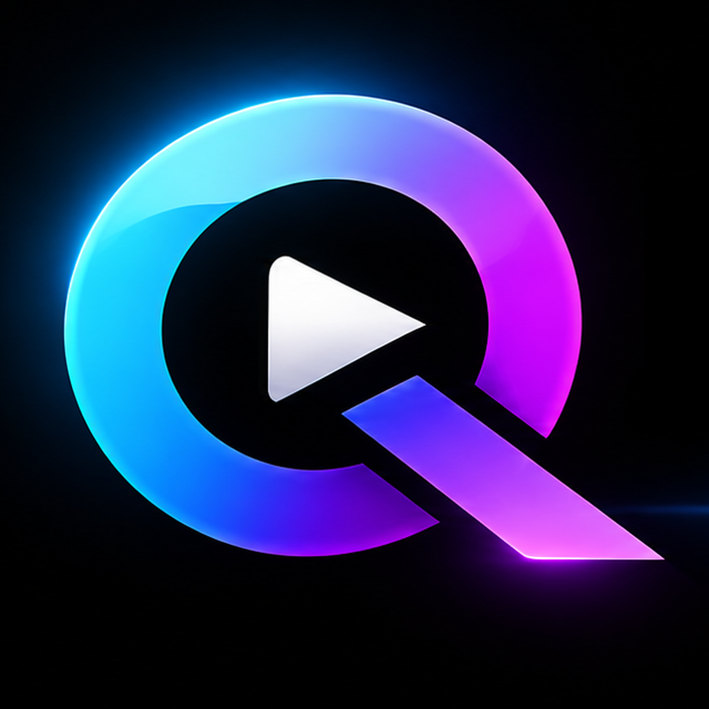
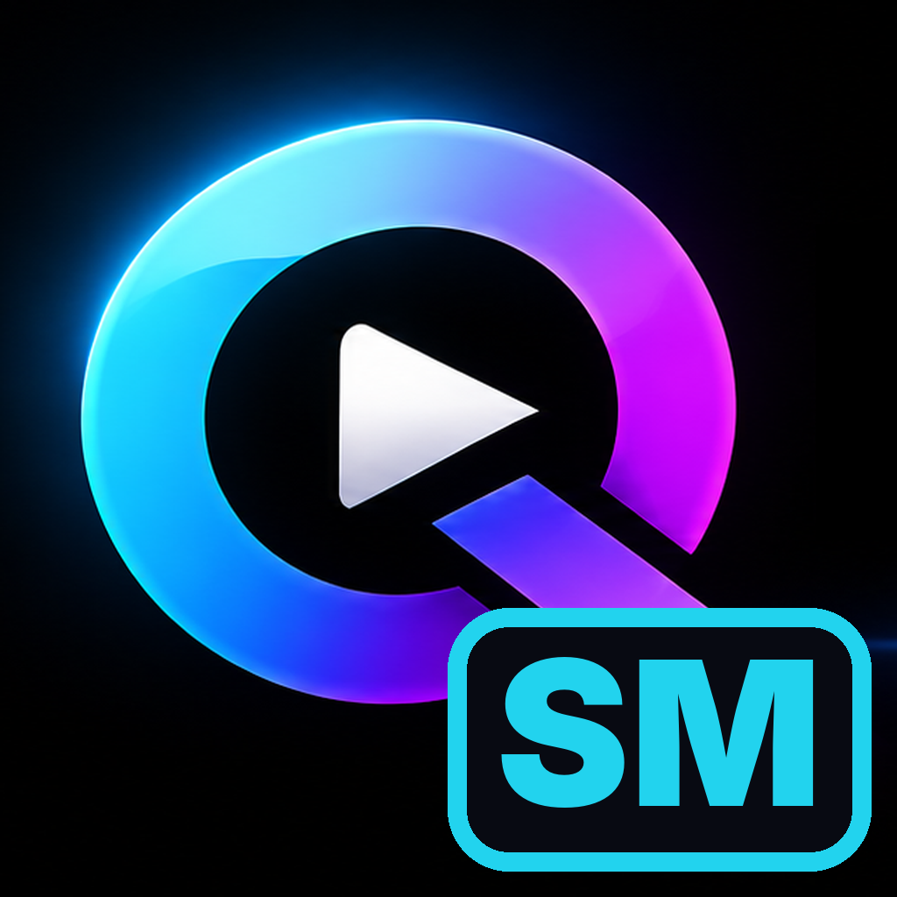
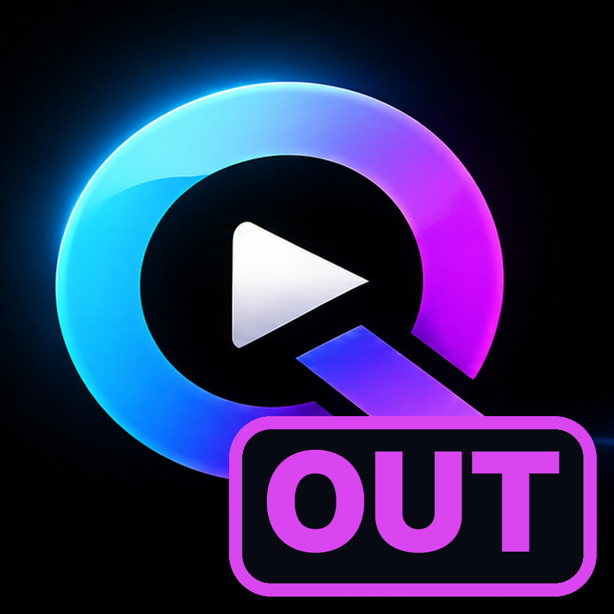
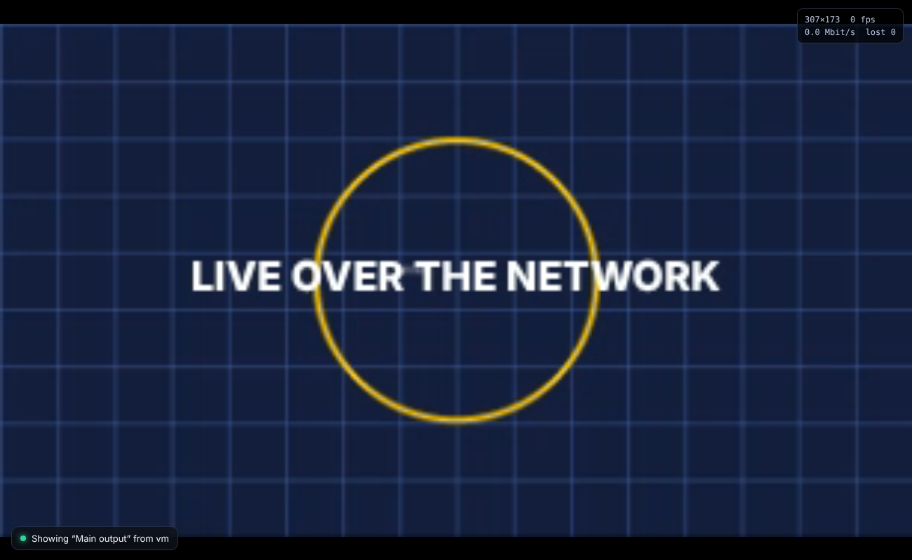
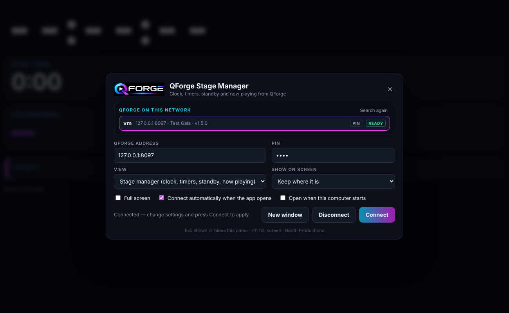

<div align="center">



### Cue-based show playback for theatre, events and broadcast

**by Booth Productions**


[**Download**](https://github.com/catalyst-91/QForge/releases/latest) · [Features](#features) · [The apps](#the-qforge-apps) · [Getting started](#getting-started) · [Show control](#show-control--integration) · [Building](#building-from-source)

</div>

---

## Overview

QForge is a cue-based playback system for live shows, in the style of QLab. It runs your audio, video, images, titles, cameras and lighting cues from one **GO** button. It handles anything from a corporate awards night to a full theatre production.

It runs as a native desktop app on Windows and macOS. Everything plays on your own computer, with no cloud account or internet connection needed. Lighting consoles, MIDI controllers, phones and tablets can all control it over your local network. Two companion apps put a stage-manager screen and extra video outputs on other computers, and built-in **NDI®¹** sends and receives video with vision mixers, streaming software and cameras.

> **Built for show day.** QForge includes show mode with a minimal operator view, autosave and crash recovery, preflight checks, rehearsal mode, main/backup sync, a show log and an admin PIN.

<div align="center">

</div>

---

## Download

| Platform | QForge | Stage Manager | Output |
|---|---|---|---|
| **Windows 10 / 11** (x64) | `QForge-1.10.0-win-x64.exe` | `QForge.Stage.Manager-1.10.0-win-x64.exe` | `QForge.Output-1.10.0-win-x64.exe` |
| **macOS** Apple Silicon (M1–M4) | `QForge-1.10.0-mac-arm64.dmg` | `QForge.Stage.Manager-1.10.0-mac-arm64.dmg` | `QForge.Output-1.10.0-mac-arm64.dmg` |
| **macOS** Intel | `QForge-1.10.0-mac-x64.dmg` | `QForge.Stage.Manager-1.10.0-mac-x64.dmg` | `QForge.Output-1.10.0-mac-x64.dmg` |

Get the latest installers from **[Releases](https://github.com/catalyst-91/QForge/releases/latest)**. Install only the apps you need on each computer.

<details>
<summary><b>First launch notes (unsigned builds)</b></summary>

- **Windows:** if SmartScreen appears, click **More info** ▸ **Run anyway**. The installer adds Start-menu and desktop shortcuts and an uninstaller.
- **macOS:** open the `.dmg` and drag the app to **Applications**. On first launch, right-click the app ▸ **Open** ▸ **Open**.
- **macOS says the app "is damaged":** run this once in Terminal (it removes the download quarantine flag):
  ```bash
  xattr -cr "/Applications/QForge.app"
  ```

</details>

---

## The QForge apps

| | App | Install it on | What it does |
|:-:|---|---|---|
|  | **QForge** | The operator's computer | The show itself: cue list, GO, audio, video, mapping, lighting and control |
|  | **QForge Stage Manager** | Backstage or prompt-desk screens | Clock, show timer, stage timer, cue countdown, standby, **up next**, now playing and a **live video player** of any output. It can also show the presenter timer, timer control, remote control, live timeline, cue list or cart, and **send its screen as an NDI source** |
|  | **QForge Output** | Projector laptops, lobby screens, LED processor PCs | Shows any QForge video output **with sound**, streamed live over the network, or **any NDI source** (camera, vision mixer, OBS, vMix), so no long video cables are needed |

The companion apps **find QForge on the network automatically** and reconnect if it restarts. They can run full screen on a chosen display, connect on launch and start with the computer, which suits unattended screens. One Output computer can drive several screens.

<table>
<tr>
<td width="50%"></td>
<td width="50%"></td>
</tr>
<tr>
<td align="center"><sub>QForge Output: a QForge output on another computer</sub></td>
<td align="center"><sub>Stage Manager: finds QForge on the network</sub></td>
</tr>
</table>

---

## Features

### Playback
- **Cue types:** audio, video and images, titles/text, camera, microphone, fade, stop/start, go to, wait, memo, group, timecode, MIDI, OSC, light (Art-Net / sACN), script, **MA Lighting** and **app control**
- **Progression:** auto-continue, auto-follow, pre-waits and post-waits, time-of-day triggers, hotkeys and a cart wall
- **Groups:** play-all, playlist, shuffle, random, **slideshow** and **step-through** modes, each with its own loops, crossfades and end actions (stop, repeat, continue, go to, fire)
- **Waveform editor:** set In and Out points, loops, markers and splits. You can also press **I / O** while a cue plays to set its In and Out
- **Crossfades on any cue:** automatic, or **manual** with a T-bar, a Take button or a MIDI fader
- Several cue lists, find/replace, renumber, bulk edit and 9 built-in show templates

### Audio
- Each cue can go to any system audio device, through named **patches** (Mains, Monitors, FX…)
- A routing matrix, EQ, ducking, a limiter, loudness normalisation and per-speaker alignment
- **5.1 / 7.1 surround:** map each file channel to an interface output
- **Vocal tools:** remove vocals (karaoke) or isolate them
- A headphone preview output, input recording and **Bluetooth / AirPlay** speaker awareness

### Video and projection
- Several outputs, with corner-pin, **mesh warp**, edge blend and masks
- Per-cue position, size, rotation, crop and mirror
- **14 transitions:** fade, cut, dip to black, wipes, push slides, zoom, blur and iris
- **Green/blue-screen keying**, luma key and one-click **background removal** for images
- Live cameras and capture cards, **NDI sources**, titles with live clocks and countdowns, and test patterns
- **Preview and Program monitors**, output blackout and **output screenshots** to a folder
- **Network outputs:** send any output, with sound, to QForge Output apps

### Crossfades and waveforms
- **Crossfade into next:** a track starts the next cue a set time before it ends and they crossfade, so a run of tracks plays as one seamless sequence from a single GO. Select tracks and press **Crossfade sequence…** to set it up in one go
- **Crossfade out of chosen cues:** pick exactly which playing tracks fade down when a cue starts, leaving the rest playing
- Equal-power, linear or S-curve crossfades, with a preview of the two waveforms and the gain curves
- **Waveforms for video** soundtracks as well as audio: in the cue list, Now Playing, the web remote and a zoomable waveform editor with trims, fades and markers
- **Clipping shown in red** on every waveform, judged at the cue's own level, with the peak level, a clip count and **Next clip**

### Automatic updates
- All three apps check GitHub for new releases, download the right installer for the computer (verified against GitHub's checksum) and install it when you choose: **Restart and install** or **Install when I quit**
- Never restarts on its own, and waits until nothing is playing before asking
- **Check for Updates…** is in the app menu (Mac) or Help menu (Windows), and automatic checks can be turned off there

### Proof of play
- Every play of an audio, video, image, text, camera or NDI cue is recorded on the computer as it happens: date, start and end time, how long it ran, whether it played in full, output, show, cue list and what started it (operator, remote, OSC, MIDI, timecode, time of day, auto-follow)
- **Reports** for today, yesterday, the last 7 days, a month or any dates, filtered by show, output, type or a name. Shows a summary by media (plays, plays in full, total time, first and last played) and the full play log
- Save as a **PDF report** for sponsors and clients, or export summary and play-log **CSV** for spreadsheets
- Mistaken fires under a set length and rehearsal-mode plays are left out; records are kept for as long as you choose

### NDI® network video
- **Send:** any QForge output becomes an NDI source with the show's sound, for vision mixers (ATEM, TriCaster), OBS, vMix, Resolume and recorders
- **Receive:** camera cues take any NDI source (PTZ cameras, mixers, other computers, phone camera apps) with optional sound, low-bandwidth mode, keying, mapping and transitions
- **QForge Output** shows any NDI source full screen; **Stage Manager** and **Output** can send their own screen as an NDI source
- Sources are found automatically, with a list of IP addresses to ask directly on routed networks
- 720p to 4K, 25 to 59.94 fps; the status bar shows each output and how many receivers are watching

### Stage timers
- Presenter and segment timers that count down, count up, or count to a time of day, with yellow and red warnings and flashing overtime
- Live ±1 min / ±10 s adjustments and presenter messages with quick presets
- Shown on a full-screen **presenter view**, the Stage Manager screen and video outputs (`{timer}` in a Text cue)
- Controlled from the Stage Timer panel, Stage Timer cues, a phone, OSC or MIDI

### Show control and remote
- A **web remote** for phones and tablets, a stage-manager view and a live timeline in the browser
- **Collaboration:** several operators edit the same show over the network
- Presentation clickers work out of the box (Page Down = GO)
- Spotify, Apple Music and system volume control from cues

### Show-day reliability
- **Show mode:** editing locks and the minimal operator view appears
- Autosave, crash recovery and version history
- **Preflight** checks for missing media, unavailable devices and conflicts, with one-click relink
- **Rehearsal mode** holds back lighting, MIDI, OSC and app-control cues
- Main/backup sync, a show log, an admin PIN and a PDF cue sheet

---

## Getting started

1. **Install QForge and open it.** File ▸ New offers templates for Theatre, Corporate, Wedding, Band, Sports, Installation, Church and Broadcast, or a blank show.
2. **Add cues.** Drag audio, video, images, lyrics (`.txt` / `.srt`) or playlists (`.m3u`) onto the cue list. Hold **Alt/Option** while dropping to make one playlist or slideshow group.
3. **Open the outputs.** Click **Outputs** in the toolbar (`Ctrl/⌘ + Shift + V`). Set up screens and mapping in **Settings ▸ Video outputs**, and NDI outputs in **Settings ▸ NDI®**.
4. **Run the show.** Press **Space** for GO and **Esc** to stop everything. **`Ctrl/⌘ + L`** switches to show mode.
5. **Save.** `Ctrl/⌘ + S` writes a `.qforge` file. Use **File ▸ Export Show Package** to collect the show and all its media into one folder.

For keyboard shortcuts, groups, loops and the remote, see the **[User guide](docs/USER-GUIDE.md)**. **Help ▸ Keyboard Shortcuts** in the app lists every shortcut.

### Stage manager screens and network outputs
On the QForge computer:
- Turn on the **web remote** in **Settings ▸ Remote & network**.
- For Output displays, leave **Network displays** on.

On the other computer, open **QForge Stage Manager** or **QForge Output**, pick your QForge from the list, and enter the PIN if one is set.

### NDI®
- **Send an output:** **Settings ▸ NDI®**, tick **Send** next to the output and give it a name. It appears on the network as `COMPUTER (name)`. QForge sends what it plays in that output, not your screen. For NDI-only outputs, tick **Virtual output** in Settings ▸ Video outputs so no screen is used.
- **Bring in a source:** **Show ▸ New NDI® Input Cue**, or set a camera cue's **Input** to *NDI® source*, then pick it from the list.
- **Output app:** in the connect panel choose **Show: An NDI® source**.
- **Windows:** install the free [NDI 6 Runtime](https://ndi.link/NDIRedistV6) (or [NDI Tools](https://ndi.video/tools/)) once. The Mac apps include the runtime.
- On a Mac, allow **Local Network** access the first time. QForge sends what it plays, not your screen, so no screen-recording permission is needed.

### Phone remote and presenter timer
- **Phone remote:** open `http://<computer-ip>:8080` on any phone or tablet on the same network.
- **Presenter countdown:** add `/?view=timer` for a full-screen countdown on a confidence monitor.
- **Timer control:** add `/?view=timers` to run the timers from a phone.

---

## Show control & integration

| Protocol | Direction | Default port |
|---|---|---|
| Web remote / Stage Manager / Output apps / collaboration | in | TCP **8080** (moves to the next free port if 8080 is taken) |
| OSC control (`/go`, `/cue/{n}/start`, `/xfade`, `/screenshot` …) | in | UDP **53000** |
| OSC feedback | out | UDP **9000** |
| Main/backup sync | in / out | UDP **53000** |
| Art-Net / sACN lighting cues | out | UDP **6454** / **5568** |
| grandMA3 command line (OSC) | out | UDP **8000** (set on the console) |
| grandMA2 command line (Telnet) | out | TCP **30000** |
| MIDI notes / CC, MIDI Show Control, MTC | in / out | USB or Bluetooth MIDI |
| LTC timecode | out | any audio output |
| NDI® discovery / video | in / out | UDP **5353** (mDNS), TCP and UDP **5959–5990+** |

Allow these through your firewall if consoles, controllers or companion apps are on other machines. Network outputs stream video at roughly **6–35 Mbit/s** depending on quality, so use wired gigabit for 1080p60 and 4K. A full-quality NDI stream is about **100–150 Mbit/s** at 1080p, so NDI needs a wired gigabit network.

---

## Building from source

Every push to `main` runs the **[Build installers](.github/workflows/build.yml)** workflow:
- It builds all three apps on GitHub's Windows and Mac machines in parallel.
- It publishes them as the release for the version in `package.json`.

To start a build by hand, use **Actions ▸ Build installers ▸ Run workflow**. To ship a new version, change `version` in the three `package.json` files and push.

To run or build locally, use [Node.js](https://nodejs.org) 20 or newer. NDI support is a small native module, so it also needs Python 3 and a C compiler (Xcode Command Line Tools on a Mac, Visual Studio Build Tools with "Desktop development with C++" on Windows):

```bash
npm run build:ndi         # once: builds native/ndi/dist (skip it and the apps run without NDI)
npm install
npm start                 # run QForge
npm run dist:win          # or dist:mac — installers go to dist/

cd apps/output            # same for apps/stage-manager
npm install && npm start
npm run dist:mac          # installers go to apps/output/dist/
```

<details>
<summary><b>Project layout</b></summary>

```
main.js, preload.js       QForge main process and secure bridge
lib/                      OSC, Art-Net/sACN, web remote, collaboration and network-display server, Telnet, app control
src/                      QForge UI and playback engine (HTML / CSS / JS, no build step)
  engine.js               Cue runtime, audio engine, transitions, crossfades
  output.js, mapping.js   Video outputs, corner-pin, mesh warp, masks
  keyer.js                Chroma / luma keying and background removal (WebGL)
  netout.js               Network outputs over WebRTC
  ndi.js                  NDI® outputs (frame capture to sender) and NDI picture/sound receivers
native/ndi/               NDI® bridge: Node-API module in C, loads the NDI runtime at run time
  include/                NDI SDK headers (MIT licence)
  vendor/                 NDI runtime for macOS (bundled) and its third-party licences
  remote/                 Web remote and stage-manager view
apps/shared/              Code shared by the companion apps (discovery, connect screen, WebRTC receiver)
apps/stage-manager/       QForge Stage Manager package and icon
apps/output/              QForge Output package and icon
.github/workflows/        Installer builds and releases
```

</details>

---

## System requirements

| | Minimum | Recommended |
|---|---|---|
| **OS** | Windows 10, macOS 12 | Windows 11, macOS 14+ |
| **GPU** | WebGL capable | Dedicated GPU or Apple Silicon (keying, mesh warp, 4K) |
| **RAM** | 8 GB | 16 GB+ |
| **Audio** | Built-in output | Multichannel USB / Thunderbolt / Dante interface |
| **Network** | Optional | Gigabit Ethernet for network outputs, NDI, consoles and collaboration |
| **NDI®** | Windows: free NDI 6 Runtime · Mac: included | Wired gigabit network |

---

## Documentation

- **[User guide](docs/USER-GUIDE.md):** keyboard, timing, loops, groups, saving and remote
- **[Changelog](CHANGELOG.md):** what changed in each version

---

## Support

QForge is made by Booth Productions. For licensing, support or custom builds, contact **Booth Productions**.

<div align="center">

**© Booth Productions. All rights reserved.**

<sub>¹ NDI® is a registered trademark of Vizrt NDI AB. QForge uses the NDI® SDK and is not a product of, or sponsored by, Vizrt NDI AB. Learn more at <a href="https://ndi.video/">ndi.video</a>.</sub>

</div>
